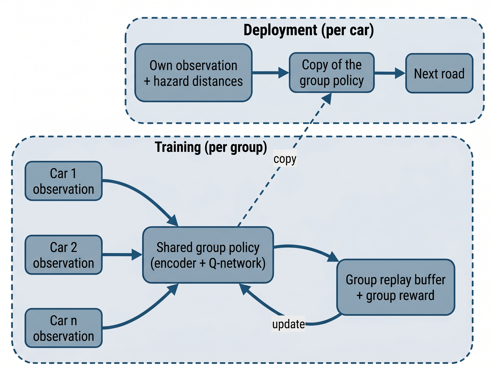
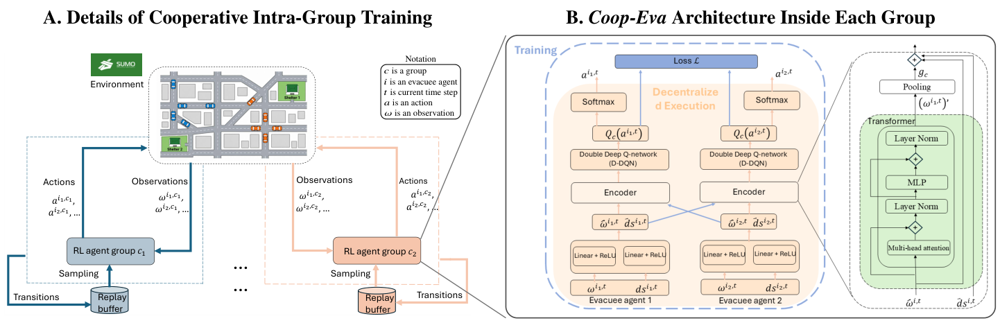
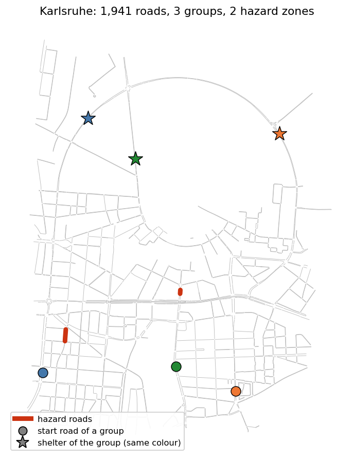
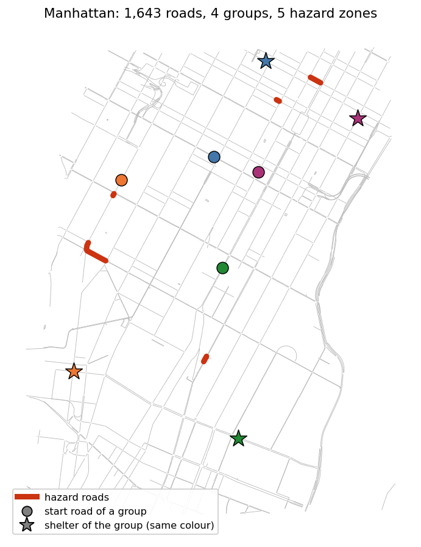
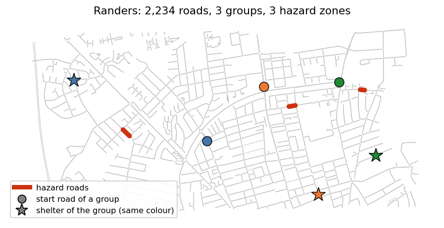

# Coop-Eva: Learning Intra-group Cooperation for Traffic Evacuation in Disaster

  

Code of the paper **Coop-Eva: Learning Intra-group Cooperation for Traffic Evacuation in Disaster**.

We proposed Coop-Eva, a multi-agent reinforcement learning (MARL) method to solve the routing problem from origin-destination for vehicles during disaster evacuation. 

Coop-Eva is distinguished by its decentralized nature, which allows evacuee vehicles to be divided into groups managed by decentralized RL agents with different policies. 
Coop-Eva minimizes travel time while mitigating risks, and vehicles within a group are cooperative. 

In training, the vehicles inside the same group optimize their group's policy. In deployment, a vehicle runs its group policy and execute the action using only its local observation, without the need for information sharing or telecommunication. This is useful when telecommunication might collapse during disasters.  

<!-- Overview figure: add docs/images/overview.png here -->
<!-- <p align="center"></p> -->

**On this page:** [🧠 How Coop-Eva works](#-how-coop-eva-works) · [🚀 Detailed Architecture](#-detailed-architecture) · [🗺 Networks](#-networks) · [🛠 Installation](#-requirements-and-installation) · [📁 Structure](#-repository-structure) · [🚦 Quick start](#-quick-start) · [🧪 Baselines](#-baselines) · [📝 Citation](#-citation)

---

## 🧠 How Coop-Eva works

<p align="center"></p>

1. **Groups:** one group per shelter, so all cars of a group have the same start area and the same shelter. Each group has its own agent.
2. **Observation (What a car sees):** its current road, the roads it can take next, the traffic density on its road, and its distance to each hazard zone.
3. **Action (What a car does):** at a junction it picks the next road among the connected ones (edge-based routing).
4. **Reward:** each car is rewarded for getting closer to its shelter fast (weight w₁ = 0.8) and for staying far from hazards (w₂ = 0.2). It gets a large penalty for entering a hazard road or for not arriving before the time limit.
5. **Intra-group training:** the cars of a group fill one replay buffer. The group policy learns from all of them, so it sees much more of the network than one car could.
6. **Decentralized execution:** at deployment each car runs its own copy of the policy, alone. 

## 🚀 Detailed Architecture

<p align="center"></p>
<p align="center"><em>A: intra-group training: each group's RL agent collects the transitions of its cars in one replay buffer. B: inside one group: each car embeds its own observation ω and hazard distances ds, the Transformer encoder combines the cars of the group, and a Double DQN predicts the Q-values; at deployment each car runs this network alone.</em></p>

- **Decentralized evacuation routing:** each car picks its next road at every junction from its own local observation.
- **Intra-group learning:** all cars of a group train one policy together. They share one replay buffer and one group reward.
- **Group encoder:** a Transformer encoder combines the observations of the cars of a group that decide in the same second. Training uses about 100 cars; testing deploys to 6,000 cars.
- **Hazard-aware:** the agent observe the distance to each hazard zone and is penalised for entering it.
- **Three real road networks:** Karlsruhe, Manhattan and Randers, simulated in [SUMO](https://eclipse.dev/sumo/) (agent-based traffic simulator).
- **Ablations and baselines:** Coop-Eva without encoder, Coop-Eva with LSTM encoder, [MAPPO](https://marllib.readthedocs.io/en/latest/algorithm/ppo_family.html#mappo-ppo-agent-with-a-centralized-critic), [MAT](https://github.com/PKU-MARL/Multi-Agent-Transformer) and Dynamic A\*.


## 🗺 Networks

| Network | Roads | Junctions | Groups (shelters) | Hazard zones | Training demand (cars) |
|---|---:|---:|---:|---:|---|
| Karlsruhe (Germany) | 1,941 | 1,022 | 3 | 2 | 100  |
| Manhattan (USA) | 1,643 | 1,112 | 4 | 5 | 80  |
| Randers (Denmark) | 2,234 | 995 | 3 | 3 | 120 |

<p align="center">
  
  
  
</p>
<p align="center"><em>The three networks. Red: hazard roads. Circle: start road of a group. Star: the group's shelter (same colour).</em></p>

Demand files (`routing-MARL/network/<network>/`):

| Use | Karlsruhe (`karl/`) | Manhattan (`manhattan2/`) | Randers (`randers/`) |
|---|---|---|---|
| file name (cars) | `karltrain100.rou.xml` (100) | `manhattan2train.rou.xml` (80) | `randers_train120.rou.xml` (120) |

## 🛠 Requirements and installation

| Item | Version used |
|---|---|
| OS | Windows 10  |
| Python | 3.11 |
| PyTorch | 2.12 with CUDA 12.6  |
| SUMO | 1.26.0 (pip packages `eclipse-sumo`, `libsumo`, `traci`, `sumolib`) |

**Step 1. Get the code**

```bash
git clone https://github.com/<user>/marl-routing-evacuation.git
cd marl-routing-evacuation
```

**Step 2. Create the environment**

```bash
conda env create -f environment.yml
conda activate coop-eva
```

Install PyTorch for your CUDA version first if `pip` downloads a CPU build (see [pytorch.org](https://pytorch.org)).

**Step 3. Check SUMO**

```bash
python -c "import libsumo, sumolib; print(libsumo.__file__)"
```

All commands below run from the `routing-MARL/` folder:

```bash
cd routing-MARL
```

## 📁 Repository structure

```text
marl-routing-evacuation/
├── README.md, requirements.txt, environment.yml
├── docs/images/                      pictures used in this README
└── routing-MARL/
    ├── train.py                      train a model (Coop-Eva, ablations, MAPPO, MAT)
    ├── infer.py                      run a trained model on a demand file (one run or a demand sweep)
    ├── metrics.py                    evacuation metrics of a finished run (from SUMO's tripinfo.xml)
    ├── run.py                        low-level runner: main.py with SUMO in-process (libsumo)
    ├── config/                       one YAML file per network and model
    │   ├── karlsruhe.yaml, manhattan.yaml, randers.yaml                    Coop-Eva
    │   ├── *_noenc.yaml                                                     ablation: no encoder
    │   └── *_lstm.yaml                                                      ablation: LSTM encoder
    ├── network/
    │   ├── karl/                     Karlsruhe: karl_kc.net.xml, karl_kc.sumocfg, demand files
    │   ├── manhattan2/               Manhattan: manhattan2.net.xml, manhattan2.sumocfg, demand files
    │   └── randers/                  Randers: randers_kc.net.xml, randers_kc.sumocfg, demand files
    ├── routing_MARl/                 Coop-Eva code
    │   ├── main.py                   entry point (train / inference)
    │   ├── simulation.py             SUMO loop: observations, decisions, rewards
    │   ├── group_agents.py           one agent per group, intra-group training, ego / group pooling
    │   ├── agent.py                  DQN agent: action choice, update (Double DQN, Huber loss)
    │   ├── Q_network.py              encoder (attention, LSTM or none) + Q-network
    │   ├── experience_buffer.py      prioritised replay buffer
    │   ├── graph_manager.py          road graph, distances to shelters and hazards
    │   ├── hazard_mask.py            optional closing of hazard roads
    │   ├── utils/reward.py           reward functions
    │   └── plotter.py                training logs
    └── baselines/
        ├── mappo_mat/                MAPPO and MAT (own code and configs; shares network/)
        └── astar_hazard/             Dynamic A*
```

## 🚦 Quick start

Run every command from the `routing-MARL/` folder.

### 1. Train a model

```bash
python train.py --config <config> --run-name <name> --seed <seed>
```

| Option | Allowed values | Meaning |
|---|---|---|
| `--config` | `karlsruhe`, `manhattan`, `randers` |  Coop-Eva on the network |
| | `karlsruhe_noenc`, `manhattan_noenc`, `randers_noenc` | Coop-Eva ablation: no encoder |
| | `karlsruhe_lstm`, `manhattan_lstm`, `randers_lstm` | Coop-Eva ablation: LSTM encoder |
| `--run-name` | any name you choose, e.g. `ran_s1` | names the output folders; reuse it as `--model` at inference |
| `--seed` | any integer (default `1`) | random seed of the training run (SUMO, PyTorch, NumPy) |
| `--algo` *(optional)* | `coopeva` (default), `mappo`, `mat` | method; with `mappo` / `mat` use a network defined `--config` |
| `--demand` *(optional)* | a training file (contains number of cars) of that network (see [Networks](#-networks)) | default: `.rou.xml` file the config |
| `--episodes`, `--steps` *(optional)* | integers | Number  of episodes, and simulation steps per episode (default: from the config) |

Examples:

```bash
python train.py --config randers --run-name randers_s1 --seed 1                 # Coop-Eva, Randers network
python train.py --config manhattan_lstm --run-name man_lstm_s1 --seed 1         # LSTM ablation, Manhattan network
python train.py --algo mappo --config karlsruhe --run-name karl_mappo --seed 1  # MAPPO method, Karlsruhe network
```

A checkpoint is saved every 10 episodes in `new_models/<run-name>/`.

### 2. Run inference

```bash
python infer.py --config <config> --model <run-name> --episode <N> --demand <file> --seed <seed>
```

| Option | Allowed values | Meaning |
|---|---|---|
| `--config` | same values as for training | must match the trained model |
| `--model` | the `--run-name` of a trained model (a folder in `new_models/`) | which model |
| `--episode` | a saved checkpoint episode: 10, 20, 30, … | which checkpoint |
| `--demand` | `karl_fw_N<N>.rou.xml`, `manhattan2_jm_N<N>.rou.xml`, `randers_fw_N<N>.rou.xml` (e.g., N = 2000) | number of cars for testing |
| `--seed` | any integer (default `1`) | random seed of the test run (SUMO, the car's action sampling) |
| `--algo` *(optional)* | `coopeva` (default), `mappo`, `mat` | method of the trained model |

Examples:

```bash
python infer.py --config randers --model randers_s1 --episode 190 --demand randers_fw_N2000.rou.xml --seed 23
```

### 3. Change the parameters

Each config file in `config/` holds all settings. The main ones:

| Key | Meaning | Example (Randers) |
|---|---|---|
| `route_file` | default training demand | `randers_train120.rou.xml` |
| `disaster.fire.disaster_zones` | hazard roads, one list per zone | `1: ['55933101#1', '-55933101#1']` (zone 1 has 2 hazard edges IDs)|
| `num_episodes`, `simulation_steps` | training length | 350 episodes, 3,000 s |
| `learning_rate`, `gamma`, `batch_size` | learning | 0.000015, 0.99, 32 |
| `softmax.tau` | exploration temperature in training | 2.7 |
| `inference_tau` | softmax temperature at inference | 1 |
| `reward.R1R2.w1`, `reward.R1R2.w2` | w1: weighs for travel time, w2: weights for hazard distance | 0.8, 0.2 |
| `hazard_close` | close hazard roads during simulation | `false` |

Change a value for one run with `--set`:

```bash
python train.py --config randers --run-name ran_w07 --set reward.R1R2.w1=0.7 --set reward.R1R2.w2=0.3
```

Or copy a config (`config/randers_my.yaml`), edit it and use `--config randers_my`.

### 4. Results during training

| What | Where | Columns |
|---|---|---|
| Arrival | `result/<network>/<run-name>/arrived_vehicles_*.txt` | `Eps, Arrived_Vehicles`
| Risk avoidance | `result/<network>/<run-name>/survived_vehicles_*.txt` | `Eps, Survived_Vehicles, Vehicles_Risk_IDs`
| Reward | `result/<network>/<run-name>/episode_reward_*.txt` | `Eps, Group, Arrived, Failed, Held_Reward_Sum, Hazard_Vehicles, …`: per episode and group; `Held_Reward_Sum` = group reward |
| Training loss | `result/<network>/<run-name>/training_log_*.txt` | `Agent, Eps, Loss, Reward` |
| Gradients | `result/<network>/<run-name>/gradient_*.txt` | `step, group, layer, mean, std, norm` |
| Models | `new_models/<run-name>/model/agent_<shelter>_ep<N>_1.pt` | one model file per training group, every 10 episodes |


`<network>` is `karl`, `manhattan2` or `randers`. 

### 5. Results after inference

Each run writes `runs/inference/<model>_ep<N>_<demand>_s<seed>/`:

| File | Content |
|---|---|
| `metrics.json` | cars, arrived, arrival %, mean / median / min / max trip time, last arrival (s) |
| `sumo/tripinfo.xml` | one line per arrived car: depart, arrival, trip duration, route length |
| `sumo/summary.xml` | network state every second: running, waiting, arrived cars, mean speed |
| `sumo/routes.xml` | the roads each car drove |

## 🧪 Baselines

### MAPPO and MAT

Code in `baselines/mappo_mat/`. Use the same `train.py` and `infer.py` as for Coop-Eva, with `--algo mappo` or `--algo mat` and a network name as `--config` (`karlsruhe`, `manhattan` or `randers`). They train on the demand (100 / 80 / 120 cars) and use the same network, groups, hazard zones, reward as Coop-Eva.

The paper tuned three keys per method (two values each):

| Setting | MAPPO key | MAT key | Values |
|---|---|---|---|
| Rollout buffer (group steps) | `model.PPO.batch_size` | `model.MAT.memory_buffer_size` | Karlsruhe 4,000 / 20,000; Manhattan 2,500 / 6,000; Randers 2,500 / 12,500 |
| GAE λ | `model.PPO.gae_lamda` | – | 0.95 / 0.7 |
| Entropy coefficient | `model.PPO.entropy_coef` | `model.MAT.entropy_coef` | 0.01 / 0.001 |

Examples (train 70 episodes, then run inference with the final checkpoint):

```bash
python train.py --algo mappo --config karlsruhe --run-name karl_mappo --seed 1 --episodes 70 --set model.PPO.batch_size=4000 --set model.PPO.gae_lamda=0.7 --set model.PPO.entropy_coef=0.01

python train.py --algo mat --config karlsruhe --run-name karl_mat --seed 1 --episodes 70 --set model.MAT.memory_buffer_size=4000 --set model.MAT.entropy_coef=0.01

python infer.py --algo mappo --config karlsruhe --model karl_mappo --episode 70 --demand karl_fw_N2000.rou.xml --seed 46
```

### Dynamic A\*

Every car is re-routed with A\*. The hazard roads get an extra cost of 10⁶ s, so A\* avoids them.

```bash
python baselines/astar_hazard/astar_closed.py --testcase randers --route-file randers_fw_N2000.rou.xml --output-dir runs/astar/randers_N2000_s23 --seed 23
```

| Parameter | Default | Meaning |
|---|---|---|
| `--testcase` | `karl`, `manhattan2` or `randers` | network folder in `network/` |
| `--route-file` | e.g. `randers_fw_N2000.rou.xml` | demand file in that folder  |
| `--steps` | `43200` | time limit in simulated seconds (the run ends earlier when all cars arrived) |
| `--output-dir` | any folder (required) | where the outputs go |
| `--seed` | `1` | SUMO random seed |
| `--trigger` | `edge` | when a car is re-routed: `edge` = each time it enters a new road;  `none` = never |
| `--hazard-cost` | `1e6` | extra travel time (s) on hazard roads, so A\* avoids them when another way exists |

Outputs in `--output-dir`: `tripinfo.xml`, `summary.xml`, `routes.xml` and `metrics.json` (arrived, stuck, teleports, cars that entered a hazard road).

## 📝 Citation

```bibtex
@article{nguyen2026coopeva,
  title   = {Coop-Eva: Learning Intra-group Cooperation for Traffic Evacuation in Disaster},
  author  = {Nguyen Tran Le Tuan, Mostafa Ameli, Hassan Idoudi, Mahdi Zargayouna},
  year    = {2026}
}
```
